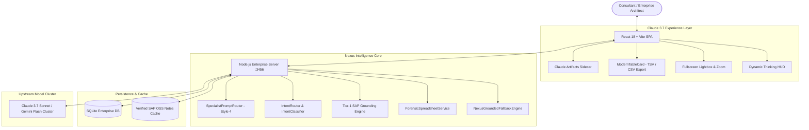

# ⚡ Nexus SAP Copilot

<div align="center">

[](https://opensource.org/licenses/MIT)
[](https://reactjs.org/)
[](https://vitejs.dev/)
[](https://nodejs.org/)
[](https://anthropic.com)
[](https://sap.com)
[](http://makeapullrequest.com)

**Enterprise-Grade SAP Architecture, Forensic Troubleshooting & Advisory Platform**  
*Powered by Claude 3.7 Natural Conversational Intelligence & Gemini AI Reasoning*

[Live Demo](#-quick-start) • [Core Capabilities](#-core-capabilities) • [Claude 3.7 Experience](#-signature-claude-37-experience) • [Architecture](#-system-architecture) • [Documentation](#-functional-domains)

</div>

---

## 📌 Executive Overview

**Nexus SAP Copilot** is a high-performance, domain-specialized AI assistant designed specifically for SAP Enterprise Architects, Functional Leads, and Solution Consultants. 

Unlike generic LLMs that produce surface-level explanations or halluncinate SAP Note numbers, Nexus combines **Tier-1 SAP Grounding**, deep **module specialization (SD, EWM, GTS, IBP, IS-Retail)**, automated **SPRO customizing runbooks**, and **forensic spreadsheet analysis** to deliver accurate, audit-ready architectural blueprints in real time.

---

## ✨ Signature Claude 3.7 Experience

Nexus features a bespoke frontend experience crafted to mirror **Claude 3.7 Sonnet**'s iconic editorial design, responsiveness, and interactivity:

```
┌──────────────────────────────────────────────────────────────────────────────────────────────┐
│  ⚡ Claude 3.7 Sonnet · Enterprise Context Active                ● Verified SAP Grounding     │
├──────────────────────────────────────────────┬───────────────────────────────────────────────┤
│  CHAT CONVERSATION (PURE WHITE #FFFFFF)      │  SPLIT-PANE ARTIFACTS SIDECAR (46% DOCKED)    │
│                                              │                                               │
│  ◉ Thought for 6s · Claude 3.7 · 1.5k tokens │  ┌─────────────────────────────────────────┐  │
│                                              │  │ 📄 cpi_ds_healthcheck.sh        [Copy]  │  │
│  "SAP Integrated Business Planning (IBP)     │  │                                         │  │
│   is a cloud-native, real-time supply chain  │  │ #!/usr/bin/env bash                     │  │
│   planning solution built on SAP BTP..."     │  │ curl -X GET "https://<tenant>.cpi..."   │  │
│                                              │  │   -H "Authorization: Bearer $TOKEN"     │  │
│  ┌────────────────────────────────────────┐  │  └─────────────────────────────────────────┘  │
│  │ 📊 5 rows · 3 cols   [Copy for Excel]  │  │                                               │
│  ├────────────────────────────────────────┤  │  Interactive Code / FSD Document Preview     │
│  │ Dimension  | Legacy APO | SAP IBP      │  │ Live Markdown / Mermaid Viewer                │
│  └────────────────────────────────────────┘  │                                               │
└──────────────────────────────────────────────┴───────────────────────────────────────────────┘
```

* **⚡ Split-Pane Artifacts Sidecar (`ClaudeArtifactSidecar`)**: Docked, resizable sidecar panel next to active conversation. Inspect live ABAP code, bash healthchecks, SQL queries, or generated FSDs side-by-side with 1-click clipboard copy and fullscreen pop-out.
* **🧠 Dynamic Thinking HUD (`ExpandableThinking`)**: Ambient amber accenting (`#D97706`), dynamic token counter (e.g. `1.2k tokens`), live progressive reasoning stages, and query-tailored cognitive sub-goals.
* **📋 Modern Interactive Table Card (`ModernTableCard`)**: Replaces standard HTML tables with interactive Claude table cards featuring row/column telemetry, real-time search filter, and 1-click **"Copy for Excel" (TSV)** and **"Export CSV"**.
* **✨ Warm Organic Shimmer Image Loader (`ModernImageLoader`)**: Caustic 45° soft light sweep (`#FAF8F5`) with progressive Gaussian blur-to-focus transition (`blur(14px) → 0px`).
* **🔍 Fullscreen Image Lightbox (`ImageLightbox`)**: Deep inspection modal with smooth mouse-wheel zoom (up to 400%), click-and-drag panning, 1-click clipboard copy (`navigator.clipboard.write([Blob])`), PNG download, and keyboard shortcuts (`Esc`, `+`, `-`, `0`).
* **🔄 Response Version Switcher (`< 1 / 2 >`)**: Multi-turn version tree allowing consultants to toggle between generation iterations and retry queries without losing historical context.

---

## 🏛️ Style 4: Natural Conversational Intelligence

Nexus implements **Style 4 Natural Conversational Intelligence**, completely discarding rigid, robotic numbered checklists (`### 1. Direct Answer... ### 8. Consulting`):
* **Principal Architect Voice**: Speaks with the authority, elegance, and nuance of a Senior Enterprise Principal Architect.
* **Direct Conceptual Opening**: Opens immediately with the core technical verdict without filler or artificial prefixes.
* **Fluid Architectural Flow**: Organically weaves overarching business context into configuration mechanics, database tables, and integration handoffs.
* **Strategic Callouts**: Employs GitHub-style alerts (`> [!NOTE]`, `> [!TIP]`, `> [!IMPORTANT]`) for critical project gotchas (e.g., Master Data Harmonization, qRFC queue jams, table lock contention).

---

## 🚀 Core Capabilities

### 1. Deep Module Specialization
* **SAP Sales & Distribution (SD)**:
  * Multi-level ATP Determination Architecture: Schedule Line Categories (`VOV6`), Availability Checking Groups (`MARC-MTVFP`), Scope of Check (`OVZ9`), and modern S/4HANA advanced ATP (aATP).
  * 16-Step Pricing Condition Technique: Field Catalog (`KOMK`/`KOMP`) → Access Sequence (`V/07`) → Condition Type (`V/06`) → Pricing Procedure (`V/08`) → `PRCD_ELEMENTS`.
  * Complete Order-to-Cash (O2C) 9-stage lifecycle with cross-module FI-AR clearing (`ACDOCA`) and CO-PA profitability derivation.
* **SAP Extended Warehouse Management (EWM)**:
  * Production Integration: Production Material Request (`/SCWM/PMR`), Staging Cockpit (`/SCWM/STAGE`), and Handling Unit (HU) staging.
  * Storage bin capacity limits, Putaway Strategies, Bin Determination, POSC, LOSC, and Wave Management (`/SCWM/WAVE`).
  * Queue and RFC triaging: `SMQ1`, `SMQ2`, bgRFC, `/SCWM/MON`, and `SLG1` application logs.
* **SAP Global Trade Services (GTS)**:
  * Sanctioned Party Screening (SPL), Levenshtein/phonetic matching, Customs Declarations, and Feeder System RFC plug-ins (`/SAPSLL/*`).
* **SAP Integrated Business Planning (IBP)**:
  * S&OP, Demand Sensing, Multi-Echelon Inventory Optimization (MEIO), HANA Calculation Views, and CPI-DS / SDI cloud integration.
* **SAP IS-Retail**:
  * Generic Articles & Variants (`MM41`), Distribution Centers vs Stores (`WB01`), Assortment & Listing (`WSLA`), Allocation Tables (`WA01`), and POS Inbound/Outbound (`WPER`/`WPUBON`).

### 2. Forensic Spreadsheet & AMS Ticket Intelligence
* Upload enterprise `.xlsx` or `.csv` ticket dumps, issue trackers, or cutover logs.
* Automatically classifies issues into **User Errors vs. System Configuration Bugs**.
* Clusters errors by root cause and maps them to concrete SAP transactions (`/SCWM/PRDO`, `ADPROD`, `SMQ2`, `CO09`).
* Generates **Shift Handover Reports** and executive operational summaries.

### 3. Automated Executive Deliverables
* **Word Functional Specification Documents (FSD)**: Formatted with standard enterprise templates (`.docx`).
* **Executive PowerPoint Presentations**: Generates 12-slide knowledge decks (`.pptx`) with editable vector graphics and process flows.
* **Top-down Mermaid Diagrams**: Automated flowchart generation with syntax validation and sanitization.

---

## 🛠️ System Architecture



---

## 💻 Tech Stack

| Tier | Technologies |
|:---|:---|
| **Frontend** | React 18, Vite 5, Tailwind CSS, Lucide Icons, Mermaid.js, KaTeX |
| **Backend** | Node.js (v20+), Express / Native HTTP Router, WebSocket Streaming |
| **AI Orchestration** | Claude 3.7 Sonnet, Gemini Flash Cluster, Custom Prompt Routing |
| **Persistence** | SQLite3, In-Memory Context Cache, Local Grounding Index |
| **Office Automation** | `docx` (Word FSD Generation), `pptxgenjs` (PowerPoint Decks), `xlsx` |

---

## ⚡ Quick Start

### 1. Prerequisites
* Node.js v20.x or higher
* npm or yarn

### 2. Clone & Install
```bash
# Clone the repository
git clone https://github.com/chtharun1901-web/nexus-sap-assistant.git
cd nexus-sap-assistant

# Install server dependencies
npm install

# Install client dependencies
cd client
npm install
cd ..
```

### 3. Environment Configuration
Create a `.env` file in the root directory:
```env
PORT=3456
GEMINI_API_KEY=your_gemini_or_claude_api_key_here
NODE_ENV=production
```

### 4. Build & Run
```bash
# Build production client bundle
cd client
npm run build
cd ..

# Start the enterprise server
node server.js
```
Open **`http://localhost:3456`** in your browser.

---

## 📂 Project Structure

```
nexus-sap-assistant/
├── client/                      # React 18 + Vite Frontend
│   ├── src/
│   │   ├── components/          # Claude 3.7 UI Suite (Sidecar, Lightbox, TableCard)
│   │   ├── views/               # Workspace, Projects, KnowledgeBase, Screen Designer
│   │   ├── services/            # Client-side PPTX/FSD generation engines
│   │   └── utils/               # Mermaid sanitizers, value stream mapping
│   └── public/                  # Assets, templates, logos
├── services/                    # Backend Intelligence Services
│   ├── SpecialistPromptRouter.js # Style 4 Natural Conversational Prompt Router
│   ├── NexusGroundedFallbackEngine.js # Zero-latency offline SAP fallback engine
│   ├── ForensicSpreadsheetService.js  # Excel/CSV ticket clustering engine
│   ├── IntentRouter.js          # Enterprise query classification
│   └── SapNewsKnowledgeEngine.js# Continuous SAP release & OSS grounding
├── server.js                    # Node.js core server & streaming orchestrator
├── db.js                        # SQLite persistence & session management
└── README.md                    # System documentation
```

---

## 📄 License

Distributed under the **MIT License**. See `LICENSE` for more information.

---

<div align="center">
Built with ❤️ for SAP Architects & Enterprise Consultants Worldwide.
</div>
